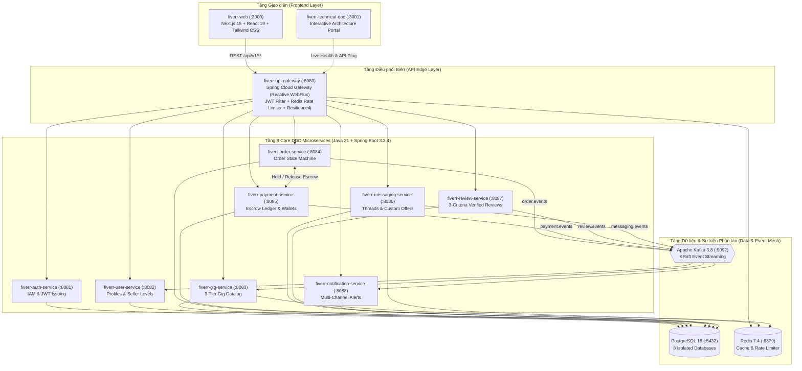
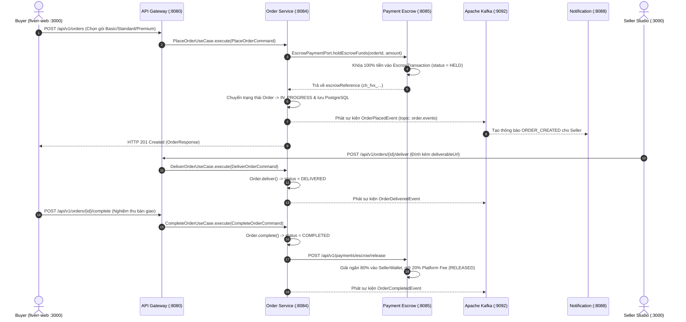

# FIVERREX (`fiverr-club`) — Enterprise Technical Documentation & Architecture Portal

Chào mừng đến với **`fiverr-technical-doc`** — Kho lưu trữ tài liệu kỹ thuật toàn diện và cổng thông tin tương tác (Interactive Documentation Web Portal) giải thích toàn bộ kiến trúc công nghệ của hệ sinh thái **FIVERREX (`https://github.com/fiverr-club`)**.

**FIVERREX** là một nền tảng **Enterprise Freelance Services & Escrow Marketplace** chuẩn Cloud-Native, được thiết kế và xây dựng từ đầu bằng:
- **Backend**: **Java 21 LTS** + **Spring Boot 3.3.4**, tuân thủ nghiêm ngặt **Domain-Driven Design (DDD)** kết hợp **Hexagonal Architecture (Ports and Adapters)**.
- **API Edge**: **Spring Cloud Gateway (Reactive WebFlux / Netty)** tích hợp **JWT Authentication**, **Redis Token-Bucket Rate Limiting**, **Resilience4j Circuit Breaker**, và **CORS**.
- **Event Mesh & Saga**: **Apache Kafka 3.8 (KRaft Mode — ZooKeeper-less)** điều phối bất đồng bộ luồng Đặt hàng (Order) & Ký quỹ (Escrow Ledger) theo mẫu **Choreography Saga Pattern**.
- **Persistence & Caching**: **PostgreSQL 16** (kiến trúc **Database-per-Service** với 8 cơ sở dữ liệu độc lập) + **Redis 7.4** Distributed Cache.
- **Frontend**: **Next.js 15 (App Router)** + **React 19** + **TypeScript 5.7** + **Tailwind CSS**, trang bị cơ chế **Resilient Dual-Mode API Client** kết nối toàn bộ **28 REST API Endpoints**.
- **Cloud & DevOps**: **Docker Compose**, **Kubernetes (StatefulSets, Deployments, HPA, NetworkPolicies, Ingress TLS)**, **Kustomize**, **Helm v3 Umbrella Chart**, và **Vercel**.

---

## Danh mục Tài liệu Chuyên sâu (`docs/`)

| STT | Tài liệu | Nội dung trọng tâm |
|---|---|---|
| 01 | [`docs/01-system-architecture.md`](./docs/01-system-architecture.md) | Kiến trúc tổng thể Microservices, luồng Request qua Reactive API Gateway (`:8080`), Rate Limiting, Circuit Breaker, JWT Edge Security. |
| 02 | [`docs/02-ddd-hexagonal-architecture.md`](./docs/02-ddd-hexagonal-architecture.md) | Phân tích chuyên sâu 4 tầng **DDD + Hexagonal Architecture** và quy tắc cốt lõi: Tại sao `Repository` luôn nằm ở `domain/repository/` thay vì `application/port/out/`. |
| 03 | [`docs/03-microservices-deep-dive.md`](./docs/03-microservices-deep-dive.md) | Giải phẫu chi tiết 9 Spring Boot Microservices (`:8080`–`:8088`), Domain Aggregates, Value Objects, Use Cases và bảng tổng hợp **28 REST API Endpoints**. |
| 04 | [`docs/04-database-and-caching.md`](./docs/04-database-and-caching.md) | Chiến lược **Database-per-Service** với 8 PostgreSQL 16 schemas, sơ đồ thực thể liên kết (**ERD Mermaid**), và chiến lược Redis 7.4 Caching. |
| 05 | [`docs/05-event-driven-kafka-saga.md`](./docs/05-event-driven-kafka-saga.md) | Kiến trúc hướng sự kiện với **Apache Kafka KRaft**, các Kafka Topics, và luồng **Escrow Order Saga** (Hold 100% -> Deliver -> Release 80%/20%). |
| 06 | [`docs/06-frontend-architecture.md`](./docs/06-frontend-architecture.md) | Kiến trúc **Next.js 15 + React 19 (`fiverr-web`)**, thiết kế `src/lib/api.ts`, DTO Normalizers, và cơ chế **Resilient Dual-Mode Fallback**. |
| 07 | [`docs/07-devops-docker-kubernetes.md`](./docs/07-devops-docker-kubernetes.md) | Giải thích Multi-stage Dockerfile (`eclipse-temurin:21`), kịch bản `./start.sh`, `init-postgres.sql`, Kubernetes StatefulSets & **Helm v3 Chart**. |
| 08 | [`docs/08-authentication-and-security.md`](./docs/08-authentication-and-security.md) | Cơ chế **Stateless JWT Edge Authentication**, mã hóa `BCrypt(12)`, ký số `HMAC-SHA256`, truyền Identity Headers (`X-User-Id`, `X-User-Roles`) & chế độ Sandbox/Strict JWT. |

---

## Bảng Tổng hợp 13 Repositories trong Hệ sinh thái `fiverr-club`

| # | Repository | Port / Production HTTPS | Tech Stack chính | Trách nhiệm Nghiệp vụ (Bounded Context) |
|---|---|---|---|---|
| 1 | [`fiverr-web`](https://github.com/fiverr-club/fiverr-web) | `:3000` / [https://fiverr-web-seven.vercel.app](https://fiverr-web-seven.vercel.app) | Next.js 15, React 19, TypeScript, Tailwind CSS | Giao diện Marketplace, 3-Tier Package Selector, Order Escrow Workspace, Seller Studio, Real-time Inbox, Live API Explorer. |
| 2 | [`fiverr-technical-doc`](https://github.com/fiverr-club/fiverr-technical-doc) | `:3001` / [https://fiverr-technical-doc.vercel.app](https://fiverr-technical-doc.vercel.app) | Next.js 15, React 19, TypeScript, Markdown | Cổng tài liệu kỹ thuật tương tác (Interactive Technical Documentation Portal) & Sổ tay kiến trúc toàn hệ thống. |
| 3 | [`fiverr-api-gateway`](https://github.com/fiverr-club/fiverr-api-gateway) | `8080` | Spring Cloud Gateway (WebFlux), Redis, JWT | Cổng API tập trung (Unified Edge Router), xác thực JWT, giới hạn tần suất (Rate Limiting), định tuyến `/api/v1/**`. |
| 4 | [`fiverr-auth-service`](https://github.com/fiverr-club/fiverr-auth-service) | `8081` | Java 21, Spring Boot 3.3.4, PostgreSQL (`fiverr_auth`) | Quản lý định danh (IAM), đăng ký, đăng nhập, mã hóa mật khẩu BCrypt, cấp phát JWT Access/Refresh Token, RBAC (`BUYER`, `SELLER`). |
| 5 | [`fiverr-user-service`](https://github.com/fiverr-club/fiverr-user-service) | `8082` | Java 21, Spring Boot 3.3.4, PostgreSQL (`fiverr_user`) | Hồ sơ Freelancer & Buyer, kỹ năng, ngôn ngữ, nâng cấp lên Seller, đánh giá hạng Seller (`NEW_SELLER`, `LEVEL_ONE`, `LEVEL_TWO`, `TOP_RATED`). |
| 6 | [`fiverr-gig-service`](https://github.com/fiverr-club/fiverr-gig-service) | `8083` | Java 21, Spring Boot 3.3.4, PostgreSQL (`fiverr_gig`), Redis | Quản lý danh mục dịch vụ (Gig Catalog), cấu hình 3 gói giá (`BASIC`, `STANDARD`, `PREMIUM`), tìm kiếm từ khóa & lọc theo danh mục. |
| 7 | [`fiverr-order-service`](https://github.com/fiverr-club/fiverr-order-service) | `8084` | Java 21, Spring Boot 3.3.4, PostgreSQL (`fiverr_order`), Kafka | Máy trạng thái đơn hàng (`IN_PROGRESS`, `DELIVERED`, `REVISION_REQUESTED`, `COMPLETED`, `CANCELLED`), quản lý bàn giao & sửa đổi. |
| 8 | [`fiverr-payment-service`](https://github.com/fiverr-club/fiverr-payment-service) | `8085` | Java 21, Spring Boot 3.3.4, PostgreSQL (`fiverr_payment`), Kafka | Sổ cái ký quỹ (`EscrowTransaction`), khóa tiền khi đặt đơn (`HELD`), giải ngân 80% vào ví `SellerWallet` & 20% phí nền tảng (`RELEASED`), rút tiền. |
| 9 | [`fiverr-messaging-service`](https://github.com/fiverr-club/fiverr-messaging-service) | `8086` | Java 21, Spring Boot 3.3.4, PostgreSQL (`fiverr_messaging`), Redis | Luồng hội thoại giữa Buyer & Seller (`Conversation`), tin nhắn thời gian thực (`ChatMessage`), gửi báo giá tùy chỉnh (`CustomOfferPayload`). |
| 10 | [`fiverr-review-service`](https://github.com/fiverr-club/fiverr-review-service) | `8087` | Java 21, Spring Boot 3.3.4, PostgreSQL (`fiverr_review`), Kafka | Đánh giá xác thực sau đơn hàng theo 3 tiêu chí (`Communication`, `Service as Described`, `Buy Again / Recommend`) & phản hồi của Seller. |
| 11 | [`fiverr-notification-service`](https://github.com/fiverr-club/fiverr-notification-service) | `8088` | Java 21, Spring Boot 3.3.4, PostgreSQL (`fiverr_notification`), Kafka | Lắng nghe sự kiện từ Kafka và gửi thông báo đa kênh (`IN_APP`, `EMAIL`, `ALL`) cho Buyer và Seller. |
| 12 | [`fiverr-k8s-infra`](https://github.com/fiverr-club/fiverr-k8s-infra) | — | Docker Compose, Kubernetes, Kustomize, Helm v3 | Toàn bộ hạ tầng Container & Cloud: `docker-compose.yml`, `init-postgres.sql`, K8s StatefulSets/Deployments/HPA, và Helm Umbrella Chart. |
| 13 | [`.github` (`org-profile`)](https://github.com/fiverr-club/.github) | — | GitHub Organization Profile & Governance | Trang tổng quan kiến trúc chính thức của tổ chức `@fiverr-club` trên GitHub. |

---

## Sơ đồ Kiến trúc Tổng thể (System Architecture)



---

## Luồng Tuần tự Đặt hàng & Ký quỹ (Escrow Order Saga Sequence)



---

## Danh sách Ports & Swagger UI URLs Toàn Hệ thống

| Dịch vụ / Thành phần | Port | Base URL / Endpoint | Swagger UI / OpenAPI |
|---|---|---|---|
| **Marketplace Web App (`fiverr-web`)** | `3000` | `http://localhost:3000` | Giao diện người dùng chính |
| **Technical Docs Portal (`fiverr-technical-doc`)** | `3001` | `http://localhost:3001` | Giao diện tài liệu kỹ thuật tương tác |
| **API Gateway (`fiverr-api-gateway`)** | `8080` | `http://localhost:8080/api/v1` | `http://localhost:8080/swagger-ui.html` |
| **Auth Service (`fiverr-auth-service`)** | `8081` | `http://localhost:8081/api/v1/auth` | `http://localhost:8081/swagger-ui/index.html` |
| **User Service (`fiverr-user-service`)** | `8082` | `http://localhost:8082/api/v1/profiles` | `http://localhost:8082/swagger-ui/index.html` |
| **Gig Service (`fiverr-gig-service`)** | `8083` | `http://localhost:8083/api/v1/gigs` | `http://localhost:8083/swagger-ui/index.html` |
| **Order Service (`fiverr-order-service`)** | `8084` | `http://localhost:8084/api/v1/orders` | `http://localhost:8084/swagger-ui/index.html` |
| **Payment Service (`fiverr-payment-service`)** | `8085` | `http://localhost:8085/api/v1/payments` | `http://localhost:8085/swagger-ui/index.html` |
| **Messaging Service (`fiverr-messaging-service`)** | `8086` | `http://localhost:8086/api/v1/messages` | `http://localhost:8086/swagger-ui/index.html` |
| **Review Service (`fiverr-review-service`)** | `8087` | `http://localhost:8087/api/v1/reviews` | `http://localhost:8087/swagger-ui/index.html` |
| **Notification Service (`fiverr-notification-service`)** | `8088` | `http://localhost:8088/api/v1/notifications` | `http://localhost:8088/swagger-ui/index.html` |
| **PostgreSQL 16 (`fiverr-postgres`)** | `5432` | `jdbc:postgresql://localhost:5432/fiverr_*` | 8 Databases độc lập |
| **Redis 7.4 (`fiverr-redis`)** | `6379` | `redis://localhost:6379` | Cache & Rate Limiter |
| **Apache Kafka 3.8 (`fiverr-kafka`)** | `9092` | `localhost:9092` (KRaft mode) | Event Streaming Broker |

---

## Hướng dẫn Khởi chạy Nhanh (Quick Start)

### 1. Khởi chạy Cổng Tài liệu Kỹ thuật Tương tác (`fiverr-technical-doc`)
```bash
cd fiverr-technical-doc
npm install
npm run dev
# Truy cập tại: http://localhost:3001
```

### 2. Khởi chạy Toàn bộ Hệ sinh thái FIVERREX bằng `./start.sh`
Tại thư mục gốc `/fiverr-club`:
```bash
# Tự động phát hiện Docker Compose hoặc chạy trực tiếp trên máy host
./start.sh

# Hoặc chọn chế độ cụ thể:
./start.sh docker    # Khởi chạy toàn bộ Postgres, Redis, Kafka, 9 Microservices & Web qua Docker Compose
./start.sh local     # Build & chạy 9 Spring Boot microservices + Next.js trực tiếp trên host
./start.sh status    # Kiểm tra trạng thái sức khỏe (Health/Port) của toàn bộ 13 tiến trình
./start.sh test      # Chạy Unit Test cho cả 9 Microservices + kiểm tra Next.js build
./start.sh stop      # Dừng toàn bộ dịch vụ
```
