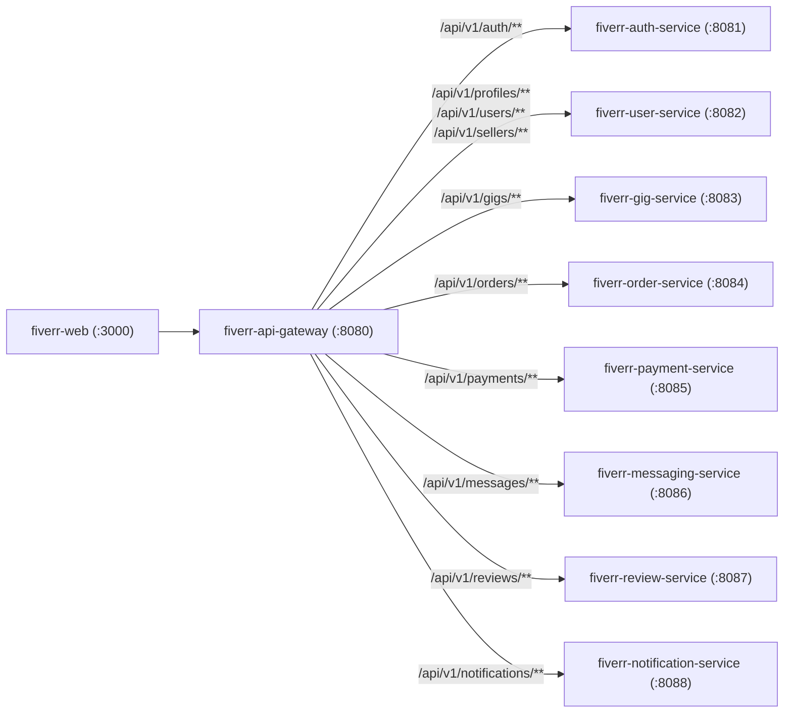

# 01. Kiến trúc Hệ thống Phân tán & API Gateway (`01-system-architecture.md`)

Tài liệu này giải thích chi tiết kiến trúc phân tán của hệ thống **FIVERREX (`fiverr-club`)**, cách một HTTP Request đi từ trình duyệt của người dùng (`fiverr-web:3000`) qua tầng điều phối biên (`fiverr-api-gateway:8080`) đến 8 Core Microservices (`:8081`–`:8088`), cũng như các cơ chế bảo mật, chịu lỗi (Resilience) và chống quá tải.

---

## 1. Triết lý Thiết kế Kiến trúc Phân tán (Cloud-Native Microservices)

Trong các sàn giao dịch dịch vụ freelance quy mô lớn (như Fiverr hay Upwork), lưu lượng truy cập có tính bất đối xứng rất cao:
- **Tác vụ đọc (Read-heavy)**: Tìm kiếm dịch vụ (`fiverr-gig-service`), xem hồ sơ freelancer (`fiverr-user-service`), xem đánh giá (`fiverr-review-service`) chiếm tới ~85% lưu lượng.
- **Tác vụ giao dịch tài chính nghiêm ngặt (ACID & Saga-critical)**: Đặt hàng (`fiverr-order-service`) và giữ tiền ký quỹ (`fiverr-payment-service`) đòi hỏi tính toàn vẹn dữ liệu tuyệt đối, không được phép thất thoát tiền hoặc tạo trạng thái không nhất quán.
- **Tác vụ thời gian thực (Real-time & Event-driven)**: Nhắn tin thương lượng (`fiverr-messaging-service`) và thông báo đa kênh (`fiverr-notification-service`) cần độ trễ thấp và xử lý bất đồng bộ.

Do đó, **FIVERREX** tách biệt hệ thống thành **1 API Gateway + 8 Core Domain Microservices**, mỗi microservice sở hữu:
1. **Bounded Context riêng biệt**: Không chia sẻ class model hay bảng cơ sở dữ liệu với service khác.
2. **Database độc lập (Database-per-Service)**: 8 database riêng trên PostgreSQL 16 (`fiverr_auth`, `fiverr_user`, `fiverr_gig`, `fiverr_order`, `fiverr_payment`, `fiverr_messaging`, `fiverr_review`, `fiverr_notification`).
3. **Khả năng mở rộng độc lập (Independent Horizontal Scaling)**: Cấu hình `HorizontalPodAutoscaler` (HPA) trên Kubernetes cho phép tăng số lượng bản sao (Replicas) của `fiverr-gig-service` khi lượng tìm kiếm tăng đột biến mà không cần tốn tài nguyên cho các service khác.

---

## 2. Giải phẫu Tầng Điều phối Biên: `fiverr-api-gateway` (`:8080`)

### 2.1. Cơ chế Reactive Non-Blocking I/O (Spring WebFlux + Project Reactor + Netty)
Khác với 8 microservice nghiệp vụ phía sau sử dụng **Spring MVC (Servlet / Tomcat + Java 21 Virtual Threads)** để tối ưu cho giao dịch JPA/JDBC với PostgreSQL, **`fiverr-api-gateway`** được xây dựng trên nền tảng **Spring Cloud Gateway (Reactive WebFlux)** chạy trên **Netty Event Loop**:
- Không khóa luồng (Non-blocking Thread-per-Request): Một số lượng nhỏ Event Loop threads có thể điều phối hàng chục nghìn kết nối đồng thời tới 8 microservices phía sau.
- Tối ưu hóa băng thông và giảm độ trễ (Tail Latency P99) tại cửa ngõ của hệ thống.

### 2.2. Bảng Định tuyến Tập trung (Unified Route Mapping `/api/v1/**`)

Mọi yêu cầu từ `fiverr-web` chỉ cần giao tiếp với duy nhất cổng `:8080`:

### 2.3. Chuỗi Bộ lọc Bảo mật & Chịu lỗi (Gateway Filter Chain)

Khi một Request đi vào `fiverr-api-gateway:8080`, nó đi qua 4 lớp bảo vệ tuần tự:

1. **Global CORS Configuration**:
   - Cho phép Origin từ `fiverr-web` (`http://localhost:3000`, `http://localhost:3001`, và domain Vercel Production), hỗ trợ các phương thức `GET`, `POST`, `PUT`, `PATCH`, `DELETE`, `OPTIONS` và các header `Authorization`, `Content-Type`, `X-User-Id`.
2. **JWT Edge Authentication Filter**:
   - Kiểm tra header `Authorization: Bearer <token>`.
   - Xác thực chữ ký số HMAC-SHA256 (`HS256`) và thời hạn (`exp`) của JWT ngay tại biên mạng (Edge) trước khi chuyển tiếp vào mạng nội bộ.
   - Trích xuất `accountId`, `username`, và `roles` (`BUYER`, `SELLER`) để đính kèm vào các header ngữ cảnh nội bộ (`X-Authenticated-User-Id`, `X-Authenticated-Roles`).
3. **Distributed Rate Limiting (Redis Token Bucket)**:
   - Tích hợp với `fiverr-redis (:6379)` sử dụng thuật toán **Token Bucket** (`RequestRateLimiter`).
   - Ngăn chặn các cuộc tấn công DDoS, Brute-force đăng nhập vào `/api/v1/auth/login` hoặc спам tạo đơn hàng liên tục.
4. **Resilience4j Circuit Breaker & Fallback**:
   - Nếu một microservice phía sau tạm thời quá tải hoặc đang khởi động lại, Circuit Breaker tại Gateway sẽ ngắt mạch nhanh (Fail-fast) và trả về phản hồi JSON chuẩn thay vì để Request treo vô thời hạn (Cascading Failure).

---

## 3. Giao tiếp Đồng bộ (REST) vs. Bất đồng bộ (Kafka Event Mesh)

Hệ thống kết hợp hài hòa 2 mô hình giao tiếp:

| Tiêu chí | Giao tiếp Đồng bộ (Synchronous REST/HTTP) | Giao tiếp Bất đồng bộ (Asynchronous Kafka KRaft) |
|---|---|---|
| **Khi nào sử dụng?** | Khi người dùng cần kết quả tức thì trên giao diện (VD: Đăng nhập, Xem danh sách Gig, Khóa tiền ký quỹ ngay khi bấm Đặt hàng). | Khi cần phát tán sự kiện nghiệp vụ cho nhiều dịch vụ phụ trợ mà không làm chậm phản hồi của người dùng. |
| **Ví dụ trong FIVERREX** | `fiverr-order-service` gọi `EscrowPaymentPort` sang `fiverr-payment-service` để khóa tiền ký quỹ (`HELD`) ngay trong giao dịch đặt hàng. | Sau khi đơn hàng được tạo/giao/hoàn tất, sự kiện được bắn lên Kafka để `fiverr-notification-service`, `fiverr-user-service`, `fiverr-gig-service` xử lý độc lập. |
| **Ưu điểm** | Phản hồi rõ ràng, người dùng biết ngay đơn hàng đã được bảo vệ bởi Escrow. | Giảm sự phụ thuộc chặt (Loose Coupling), dễ dàng mở rộng thêm Consumer mới mà không cần sửa code của Producer. |
