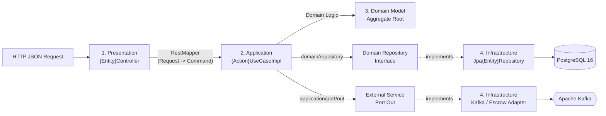

# 02. Kiến trúc DDD & Hexagonal (Ports and Adapters) (`02-ddd-hexagonal-architecture.md`)

Toàn bộ 8 Core Microservices của **FIVERREX (`fiverr-club`)** được thiết kế dựa trên **Domain-Driven Design (DDD)** kết hợp **Hexagonal Architecture (Ports and Adapters)**. Tài liệu này giải thích chi tiết cấu trúc 4 tầng, luồng dữ liệu, và các quy tắc kiến trúc bất khả xâm phạm của dự án.

---

## 1. Tại sao chọn DDD + Hexagonal Architecture?

Trong các hệ thống thương mại điện tử và tài chính ký quỹ (Escrow), logic nghiệp vụ (như trạng thái đơn hàng, phí nền tảng 20%, điều kiện rút tiền, đánh giá 3 tiêu chí) rất phức tạp và thay đổi liên tục:
- **Domain Independence (Độc lập miền nghiệp vụ)**: Tầng `domain/` hoàn toàn thuần Java 21, không phụ thuộc vào Spring Framework, Hibernate/JPA, Kafka hay bất kỳ thư viện hạ tầng nào.
- **Dependency Inversion (Đảo ngược phụ thuộc)**: Mọi phụ thuộc đều hướng vào bên trong (`Presentation -> Application -> Domain <- Infrastructure`).
- **Testability (Khả năng kiểm thử tối đa)**: Có thể kiểm thử 100% logic nghiệp vụ của `Domain` và `UseCase` bằng Unit Test (JUnit 5 + Mockito) trong vài mili-giây mà không cần bật Database hay Kafka.

---

## 2. Cấu trúc 4 Tầng Chuẩn (4-Layer Module Structure)

Mỗi microservice trong `club.fiverr.{module}` đều tuân thủ cấu trúc thư mục đồng nhất:

```text
src/main/java/club/fiverr/{module}/
├── presentation/rest/                  # 1. TẦNG PRESENTATION (Inbound HTTP Adapter)
│   ├── {Entity}Controller.java         # REST Controller (@RestController)
│   ├── ServiceStatusController.java    # Health & Metadata Endpoint
│   ├── request/                        # HTTP Request DTOs (Jakarta Validation)
│   ├── response/                       # HTTP Response DTOs
│   └── mapper/                         # Chuyển đổi Request -> Command, Result -> Response
│
├── application/                        # 2. TẦNG APPLICATION (Use Case Orchestration)
│   ├── dto/
│   │   ├── command/                    # Input Command Records (bất biến)
│   │   └── result/                     # Output Result Records (bất biến)
│   ├── mapper/
│   │   └── {Entity}ResultMapper.java   # Chuyển đổi Domain Model -> Result DTO
│   ├── port/
│   │   ├── in/                         # Inbound Ports (Use Case Interfaces)
│   │   └── out/                        # Outbound Ports (CHỈ dành cho dịch vụ ngoại vi!)
│   └── usecase/                        # Triển khai Use Case (@Service, @Transactional)
│
├── domain/                             # 3. TẦNG DOMAIN (Trái tim Nghiệp vụ - Pure Java)
│   ├── model/                          # Aggregate Roots, Entities, Value Objects, Enums
│   ├── repository/                     # ✅ BẮT BUỘC: Repository Interfaces nằm tại đây!
│   │   └── {Entity}Repository.java
│   ├── service/                        # Domain Services xử lý nghiệp vụ liên thực thể
│   └── exception/                      # Domain Exceptions đặc thù
│
└── infrastructure/                     # 4. TẦNG INFRASTRUCTURE (Outbound Adapters & Config)
    ├── persistence/
    │   ├── entity/                     # JPA Entities (@Entity, @Table)
    │   ├── mapper/                     # Chuyển đổi 2 chiều JPA Entity <-> Domain Model
    │   └── repository/                 # ✅ Triển khai Repository tại đây:
    │       ├── Jpa{Entity}Repository.java    # Adapter implements domain/repository
    │       └── {Entity}JpaRepository.java    # Spring Data JPA Interface
    ├── adapter/                        # Adapters triển khai application/port/out/ (Kafka, HTTP, BCrypt)
    └── config/                         # OpenApiConfig, DataInitializer (Seed Data)
```

---

## 3. Quy tắc Kiến trúc Quan trọng Nhất: Vị trí của `Repository`

> [!IMPORTANT]
> **QUY TẮC BẮT BUỘC TRONG TOÀN BỘ DỰ ÁN FIVERREX:**
> Giao diện `Repository` (`{Entity}Repository.java`) **LUÔN LUÔN** nằm trong `domain/repository/`, **TUYỆT ĐỐI KHÔNG BAO GIỜ** đặt trong `application/port/out/`.

### Tại sao?
1. **Theo đúng nguyên lý DDD của Eric Evans**: Repository là một khái niệm thuộc về Domain Layer — nó định nghĩa hợp đồng lưu trữ và truy xuất các **Aggregate Root** của miền nghiệp vụ (`OrderRepository`, `GigRepository`, `EscrowTransactionRepository`).
2. **Phân định rõ trách nhiệm với `application/port/out/`**:
   - `domain/repository/` dùng cho **Persistence của Domain Aggregate**.
   - `application/port/out/` **CHỈ** dùng cho các **dịch vụ kỹ thuật hoặc hệ thống bên ngoài** như:
     - `PasswordEncoderPort` / `TokenProviderPort` (`fiverr-auth-service`)
     - `EscrowPaymentPort` / `OrderEventPublisherPort` (`fiverr-order-service`)
     - `PaymentEventPublisherPort` (`fiverr-payment-service`)
     - `ReviewEventPublisherPort` (`fiverr-review-service`)
     - `NotificationSenderPort` (`fiverr-notification-service`)

---

## 4. Code Thực tế Minh họa từ `fiverr-order-service`

### 4.1. Domain Repository Interface (`domain/repository/OrderRepository.java`)
```java
package club.fiverr.order.domain.repository;

import club.fiverr.order.domain.model.Order;
import java.util.List;
import java.util.Optional;
import java.util.UUID;

public interface OrderRepository {
    Order save(Order order);
    Optional<Order> findById(UUID id);
    List<Order> findAll();
    List<Order> findByBuyerId(UUID buyerId);
    List<Order> findBySellerId(UUID sellerId);
}
```

### 4.2. Infrastructure Persistence Adapter (`infrastructure/persistence/repository/JpaOrderRepository.java`)
```java
package club.fiverr.order.infrastructure.persistence.repository;

import club.fiverr.order.domain.model.Order;
import club.fiverr.order.domain.repository.OrderRepository;
import club.fiverr.order.infrastructure.persistence.entity.OrderEntity;
import club.fiverr.order.infrastructure.persistence.mapper.OrderPersistenceMapper;
import org.springframework.stereotype.Repository;

import java.util.List;
import java.util.Optional;
import java.util.UUID;

@Repository
public class JpaOrderRepository implements OrderRepository {

    private final OrderJpaRepository jpaRepository;
    private final OrderPersistenceMapper mapper;

    public JpaOrderRepository(OrderJpaRepository jpaRepository, OrderPersistenceMapper mapper) {
        this.jpaRepository = jpaRepository;
        this.mapper = mapper;
    }

    @Override
    public Order save(Order order) {
        OrderEntity saved = jpaRepository.save(mapper.toEntity(order));
        return mapper.toDomain(saved);
    }

    @Override
    public Optional<Order> findById(UUID id) {
        return jpaRepository.findById(id).map(mapper::toDomain);
    }
    // ...
}
```

### 4.3. Application Use Case (`application/usecase/PlaceOrderUseCaseImpl.java`)
Chú ý cách `PlaceOrderUseCaseImpl` kết hợp cả **Domain Repository** (`domain/repository/OrderRepository`) lẫn **Outbound Ports** (`application/port/out/EscrowPaymentPort` & `OrderEventPublisherPort`):

```java
package club.fiverr.order.application.usecase;

import club.fiverr.order.application.dto.command.PlaceOrderCommand;
import club.fiverr.order.application.dto.result.OrderResult;
import club.fiverr.order.application.mapper.OrderResultMapper;
import club.fiverr.order.application.port.in.PlaceOrderUseCase;
import club.fiverr.order.application.port.out.EscrowPaymentPort;
import club.fiverr.order.application.port.out.OrderEventPublisherPort;
import club.fiverr.order.domain.model.Order;
import club.fiverr.order.domain.repository.OrderRepository;
import org.springframework.stereotype.Service;
import org.springframework.transaction.annotation.Transactional;

@Service
public class PlaceOrderUseCaseImpl implements PlaceOrderUseCase {

    private final OrderRepository orderRepository;               // ✅ Từ domain/repository/
    private final EscrowPaymentPort escrowPaymentPort;           // ✅ Từ application/port/out/
    private final OrderEventPublisherPort orderEventPublisherPort; // ✅ Từ application/port/out/

    public PlaceOrderUseCaseImpl(
            OrderRepository orderRepository,
            EscrowPaymentPort escrowPaymentPort,
            OrderEventPublisherPort orderEventPublisherPort
    ) {
        this.orderRepository = orderRepository;
        this.escrowPaymentPort = escrowPaymentPort;
        this.orderEventPublisherPort = orderEventPublisherPort;
    }

    @Override
    @Transactional
    public OrderResult execute(PlaceOrderCommand command) {
        // 1. Khởi tạo Aggregate Root Order và kiểm tra các bất biến (Invariants)
        Order order = Order.createNew(
                command.gigId(),
                command.buyerId(),
                command.sellerId(),
                command.packageTier(),
                command.amount(),
                command.requirements(),
                command.maxRevisions()
        );

        // 2. Gọi Outbound Port để khóa tiền ký quỹ (Escrow)
        String escrowRef = escrowPaymentPort.holdEscrowFunds(
                order.getId(),
                order.getBuyerId(),
                order.getSellerId(),
                order.getAmount()
        );
        order.startProgress(escrowRef);

        // 3. Lưu Aggregate qua Domain Repository
        Order saved = orderRepository.save(order);

        // 4. Phát sự kiện Domain qua Outbound Event Publisher Port (Kafka)
        orderEventPublisherPort.publishOrderPlaced(saved);

        // 5. Chuyển đổi sang Result DTO trả về cho Controller
        return OrderResultMapper.toResult(saved);
    }
}
```

---

## 5. Luồng Đi của Dữ liệu Qua 4 Tầng (End-to-End Data Flow)


