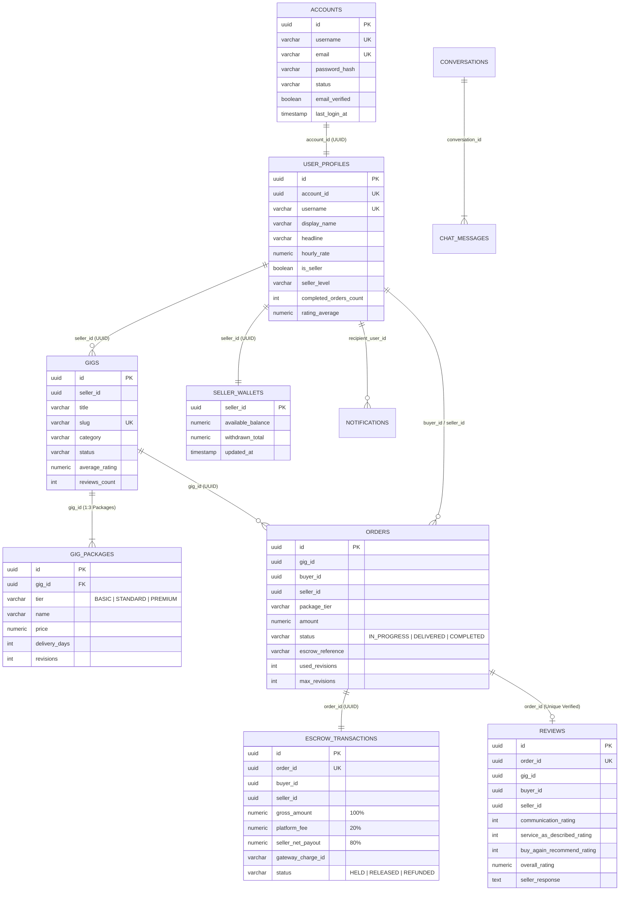

# 04. Thiết kế Cơ sở Dữ liệu (Database-per-Service) & Redis Caching (`04-database-and-caching.md`)

Tài liệu này giải thích kiến trúc lưu trữ dữ liệu của **FIVERREX (`fiverr-club`)**, bao gồm chiến lược **Database-per-Service** trên **PostgreSQL 16 (`:5432`)**, sơ đồ thực thể liên kết (**ERD**) của 8 cơ sở dữ liệu độc lập, và cơ chế bộ nhớ đệm phân tán với **Redis 7.4 (`:6379`)**.

---

## 1. Chiến lược Database-per-Service trên PostgreSQL 16

Trong kiến trúc Microservices chuẩn DDD, mỗi microservice là chủ sở hữu duy nhất của dữ liệu thuộc Bounded Context của mình. Không có bất kỳ microservice nào được phép truy vấn trực tiếp bảng (JOIN SQL) của microservice khác.

Khi khởi tạo container `fiverr-postgres`, kịch bản `/docker-entrypoint-initdb.d/01-init-postgres.sql` tự động tạo **8 cơ sở dữ liệu tách biệt hoàn toàn**:

```sql
CREATE DATABASE fiverr_auth;
CREATE DATABASE fiverr_user;
CREATE DATABASE fiverr_gig;
CREATE DATABASE fiverr_order;
CREATE DATABASE fiverr_payment;
CREATE DATABASE fiverr_messaging;
CREATE DATABASE fiverr_review;
CREATE DATABASE fiverr_notification;
```

### Bảng Ánh xạ 8 Databases & Bảng Chính (JPA Entities)

| Database | Microservice Sở hữu | Port | Các Bảng Chính (Tables) | Đặc điểm Kỹ thuật & Chỉ mục (Indexes) |
|---|---|---|---|---|
| `fiverr_auth` | `fiverr-auth-service` | `8081` | `accounts`, `account_roles` | Ràng buộc `UNIQUE` trên `username` và `email`, lưu `password_hash` chuẩn BCrypt. |
| `fiverr_user` | `fiverr-user-service` | `8082` | `user_profiles`, `user_languages`, `user_skills` | Liên kết logic tới `account_id` (UUID), lưu cấp bậc `seller_level` và `rating_average`. |
| `fiverr_gig` | `fiverr-gig-service` | `8083` | `gigs`, `gig_packages` | Quan hệ `1-N` giữa `gigs` và 3 gói `gig_packages` (`BASIC`, `STANDARD`, `PREMIUM`). |
| `fiverr_order` | `fiverr-order-service` | `8084` | `orders` | Lưu trạng thái máy trạng thái (`status`), `escrow_reference`, `used_revisions`, `max_revisions`. |
| `fiverr_payment` | `fiverr-payment-service` | `8085` | `escrow_transactions`, `seller_wallets` | Tách biệt rõ Sổ cái ký quỹ (`HELD`/`RELEASED`) và Ví số dư khả dụng của Seller (`BigDecimal` 19,2). |
| `fiverr_messaging` | `fiverr-messaging-service` | `8086` | `conversations`, `chat_messages` | Lưu lịch sử tin nhắn và cấu trúc nhúng `@Embedded` cho `CustomOfferPayload`. |
| `fiverr_review` | `fiverr-review-service` | `8087` | `reviews` | Ràng buộc `UNIQUE(order_id)` đảm bảo mỗi đơn hàng chỉ được đánh giá xác thực 1 lần. |
| `fiverr_notification`| `fiverr-notification-service`| `8088` | `notifications` | Theo dõi kênh gửi (`IN_APP`, `EMAIL`, `ALL`) và trạng thái đã đọc (`read`, `read_at`). |

---

## 2. Sơ đồ ERD Liên kết Logic Giữa 8 Bounded Contexts (Mermaid `erDiagram`)

> [!NOTE]
> Các đường nối dưới đây thể hiện mối liên kết thông qua **Global Domain UUID (`accountId`, `sellerId`, `buyerId`, `gigId`, `orderId`)** được đồng bộ qua REST API và sự kiện Apache Kafka, không phải khóa ngoại vật lý xuyên database.



---

## 3. Chiến lược Caching & Distributed State với Redis 7.4 (`:6379`)

Container `fiverr-redis` (`redis:7.4-alpine` chạy với `--appendonly yes`) đảm nhiệm 3 vai trò cốt lõi:

1. **API Gateway Distributed Rate Limiting (`fiverr-api-gateway`)**:
   - Lưu trữ bộ đếm Token Bucket theo địa chỉ IP / User ID với TTL tự động để giới hạn tốc độ gọi API trên toàn cụm Kubernetes.
2. **Gig Catalog & Search Caching (`fiverr-gig-service`)**:
   - Các truy vấn danh sách Gig (`GET /api/v1/gigs`) và tìm kiếm theo danh mục được đệm trên Redis để giảm tải cho PostgreSQL `fiverr_gig`.
   - Khi Seller tạo Gig mới (`POST /api/v1/gigs`) hoặc có đánh giá mới làm thay đổi điểm trung bình, bộ đệm tương ứng được vô hiệu hóa (Cache Eviction).
3. **Real-Time Presence & Unread Counters (`fiverr-messaging-service`)**:
   - Hỗ trợ theo dõi trạng thái trực tuyến của Freelancer và tốc độ phản hồi tin nhắn trong `fiverr-messaging-service`.
