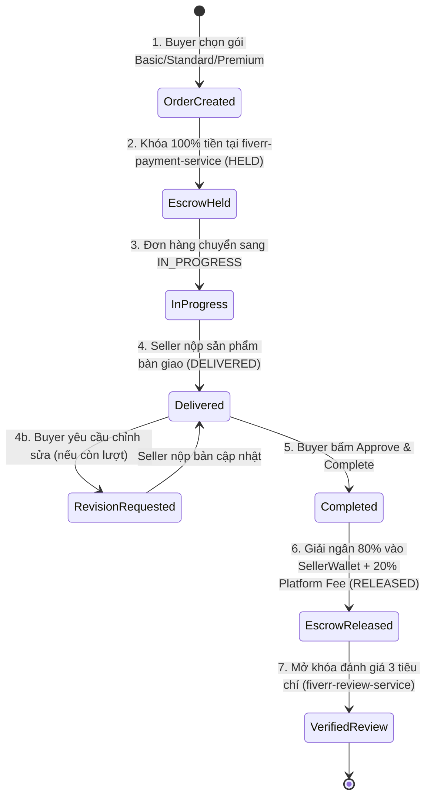

# 05. Kiến trúc Hướng Sự kiện (Apache Kafka KRaft) & Escrow Saga (`05-event-driven-kafka-saga.md`)

Tài liệu này giải thích cách **FIVERREX (`fiverr-club`)** vận hành kiến trúc hướng sự kiện (**Event-Driven Architecture - EDA**) sử dụng **Apache Kafka 3.8 ở chế độ KRaft (ZooKeeper-less)** và mẫu thiết kế **Saga Pattern** cho luồng Đặt hàng – Ký quỹ – Giải ngân – Đánh giá.

---

## 1. Tại sao sử dụng Apache Kafka KRaft Mode (`apache/kafka:3.8.0`)?

Trước đây, việc vận hành Apache Kafka đòi hỏi phải duy trì thêm một cụm Apache ZooKeeper riêng biệt để quản lý metadata của broker và bầu chọn leader. Trong **FIVERREX**, chúng tôi sử dụng **Apache Kafka KRaft (Kafka Raft Metadata mode)**:
- **Kiến trúc hợp nhất**: Một tiến trình duy nhất đóng cả hai vai trò `KAFKA_PROCESS_ROLES: broker,controller` thông qua giao thức đồng thuận Raft trên cổng `:9093`, trong khi phục vụ các Microservices qua cổng `:9092`.
- **Khởi động cực nhanh & Tiết kiệm bộ nhớ**: Phù hợp hoàn hảo cho cả môi trường phát triển cục bộ (`docker-compose.yml`) lẫn triển khai `StatefulSet` trên Kubernetes (`fiverr-k8s-infra`).

---

## 2. Danh mục Các Kafka Topics trong Hệ thống

| Kafka Topic | Producer Service | Consumer Services | Các Sự kiện Chính (Domain Events) |
|---|---|---|---|
| `order.events` | `fiverr-order-service (:8084)` | `fiverr-payment-service`, `fiverr-notification-service`, `fiverr-user-service` | `OrderPlacedEvent`, `OrderDeliveredEvent`, `OrderRevisionRequestedEvent`, `OrderCompletedEvent` |
| `payment.events` | `fiverr-payment-service (:8085)` | `fiverr-order-service`, `fiverr-notification-service` | `EscrowHeldEvent`, `EscrowReleasedEvent`, `SellerWithdrawalCompletedEvent` |
| `review.events` | `fiverr-review-service (:8087)` | `fiverr-gig-service`, `fiverr-user-service`, `fiverr-notification-service` | `ReviewSubmittedEvent`, `SellerResponseAddedEvent` |
| `messaging.events` | `fiverr-messaging-service (:8086)` | `fiverr-notification-service` | `ChatMessageSentEvent`, `CustomOfferCreatedEvent` |

---

## 3. Phân tích Chi tiết Luồng Escrow Order Saga (6 Bước)

Trong một sàn giao dịch Freelance, tiền của Buyer **không bao giờ** chuyển thẳng cho Seller ngay khi đặt hàng, vì Seller chưa bàn giao sản phẩm. Ngược lại, Seller cũng không làm việc nếu chưa chắc chắn Buyer đã nạp đủ ngân sách.

**FIVERREX** giải quyết bài toán này bằng **Escrow Ledger & Order Saga**:

### Bước 1 & 2: Đặt hàng và Khóa tiền Ký quỹ (`PlaceOrderUseCase` -> `HoldEscrowUseCase`)
1. Buyer gửi `POST /api/v1/orders` với `gigId`, `packageTier` (`BASIC`, `STANDARD`, `PREMIUM`), `amount` và `requirements`.
2. `PlaceOrderUseCaseImpl` khởi tạo Aggregate `Order` và gọi `EscrowPaymentPort.holdEscrowFunds(...)`.
3. `fiverr-payment-service` tạo bản ghi `EscrowTransaction`:
   - `grossAmount` = $100\%$ giá trị gói (ví dụ: $\$995.00$).
   - `platformFee` = $20\%$ phí nền tảng ($\$199.00$).
   - `sellerNetPayout` = $80\%$ thực nhận của Seller ($\$796.00$).
   - `status` = `HELD` (tiền bị đóng băng trong sổ cái ký quỹ).
4. `Order` lưu mã `escrowReference` (`ch_fvx_...`), chuyển sang trạng thái `IN_PROGRESS` và phát sự kiện `OrderPlacedEvent` lên topic `order.events`.

### Bước 3: Bàn giao Sản phẩm & Yêu cầu Chỉnh sửa (`DeliverOrderUseCase` / `RequestRevisionUseCase`)
1. Seller tải lên sản phẩm qua `POST /api/v1/orders/{id}/deliver` kèm `deliveryNote` và `deliverableUrl`.
2. `Order.deliver(...)` kiểm tra trạng thái hợp lệ (phải đang ở `IN_PROGRESS` hoặc `REVISION_REQUESTED`), chuyển trạng thái sang `DELIVERED` và bắn sự kiện `OrderDeliveredEvent`.
3. Nếu Buyer chưa hài lòng và muốn sửa đổi (`POST /api/v1/orders/{id}/revisions`), `Order.requestRevision()` kiểm tra invariant `usedRevisions < maxRevisions`:
   - Nếu vượt quá số lần sửa đổi tối đa của gói, Domain Model ném ngoại lệ `InvalidOrderStateException`.
   - Nếu hợp lệ, tăng `usedRevisions + 1` và chuyển trạng thái sang `REVISION_REQUESTED`.

### Bước 4: Nghiệm thu & Giải ngân Ký quỹ 80/20 (`CompleteOrderUseCase` -> `ReleaseEscrowUseCase`)
1. Khi Buyer hài lòng và bấm **Approve & Release Escrow** (`POST /api/v1/orders/{id}/complete`), `Order.complete()` chuyển trạng thái sang `COMPLETED`.
2. `ReleaseEscrowUseCaseImpl` tại `fiverr-payment-service` tìm `EscrowTransaction` theo `orderId`:
   - Chuyển trạng thái `EscrowTransaction` từ `HELD` sang `RELEASED`.
   - Cộng trực tiếp khoản `sellerNetPayout` ($80\%$) vào `availableBalance` trong bảng `seller_wallets` của Seller.
   - Phát sự kiện `EscrowReleasedEvent` lên topic `payment.events`.

### Bước 5 & 6: Đánh giá 3 Tiêu chí & Thông báo Đa kênh
1. Sau khi đơn hàng hoàn tất, Buyer gửi đánh giá qua `POST /api/v1/reviews` với 3 điểm số độc lập:
   - `communicationRating` (Giao tiếp của Seller)
   - `serviceAsDescribedRating` (Chất lượng đúng mô tả)
   - `buyAgainRecommendRating` (Khả năng giới thiệu / thuê lại)
2. Aggregate `Review` tự động tính `overallRating = round((c1 + c2 + c3) / 3.0, 1)` và phát sự kiện `ReviewSubmittedEvent` lên `review.events`.
3. `fiverr-gig-service` và `fiverr-user-service` cập nhật điểm đánh giá trung bình, đồng thời `fiverr-notification-service` tạo thông báo `REVIEW_RECEIVED` cho Seller.
