# 07. Hạ tầng DevOps: Docker Multi-Stage, Kubernetes & Helm v3 (`07-devops-docker-kubernetes.md`)

Tài liệu này giải thích toàn bộ quy trình đóng gói, tự động hóa khởi chạy cục bộ (`./start.sh`) và triển khai lên cụm **Kubernetes** thông qua **Kustomize** và **Helm v3 Umbrella Chart** trong kho lưu trữ `fiverr-k8s-infra`.

---

## 1. Tối ưu hóa Docker Multi-Stage Builds cho Java 21 & Next.js 15

### 1.1. Backend Spring Boot 3.3.4 (`eclipse-temurin:21`)
Tất cả 9 microservices (`fiverr-api-gateway` và 8 core services) đều sử dụng **Multi-stage Dockerfile** để tách biệt môi trường biên dịch Maven (JDK) khỏi môi trường chạy thực tế (JRE Alpine nhẹ và bảo mật):

```dockerfile
# Stage 1: Biên dịch mã nguồn với Maven & JDK 21
FROM maven:3.9.9-eclipse-temurin-21-alpine AS builder
WORKDIR /workspace
COPY pom.xml .
RUN mvn dependency:go-offline -B
COPY src ./src
RUN mvn clean package -DskipTests -B

# Stage 2: Chạy ứng dụng trên JRE 21 Alpine siêu nhẹ với Non-root User
FROM eclipse-temurin:21-jre-alpine
WORKDIR /app
RUN addgroup -S fiverr && adduser -S fiverr -G fiverr
COPY --from=builder /workspace/target/*.jar app.jar
USER fiverr
EXPOSE 8080
ENTRYPOINT ["java", "-XX:+UseContainerSupport", "-XX:MaxRAMPercentage=75.0", "-jar", "app.jar"]
```

### 1.2. Frontend Next.js 15 Standalone (`node:20-alpine`)
Cả `fiverr-web` và `fiverr-technical-doc` đều bật cấu hình `output: 'standalone'` trong `next.config.mjs`, giúp image cuối cùng chỉ chứa đúng các file thực thi cần thiết (`server.js`), giảm kích thước image từ ~1.1GB xuống còn ~140MB.

---

## 2. Kịch bản Tự động hóa Hợp nhất: `./start.sh`

Tại thư mục gốc `/fiverr-club/start.sh`, kịch bản điều phối cung cấp 7 chế độ vận hành chỉ với 1 câu lệnh:

| Câu lệnh | Hành động thực thi |
|---|---|
| `./start.sh` (hoặc `./start.sh auto`) | Tự động kiểm tra Docker daemon: nếu Docker đang bật sẽ chạy `docker compose up --build -d`, ngược lại sẽ biên dịch và chạy trực tiếp trên máy host. |
| `./start.sh docker` | Giải phóng các cổng bị chiếm dụng (`3000`, `8080`–`8088`), sau đó khởi chạy toàn bộ 13 containers qua `fiverr-k8s-infra/docker-compose.yml`. |
| `./start.sh local` | Khởi chạy 9 tiến trình Spring Boot (`mvn spring-boot:run`) và Next.js (`npm run dev`) ở chế độ nền, lưu PID vào `.pids/` và log vào `.logs/`. |
| `./start.sh status` | Quét toàn bộ các cổng `:3000`, `:8080`–`:8088`, `:5432`, `:6379`, `:9092` và báo cáo trạng thái `[UP]` / `[DOWN]`. |
| `./start.sh test` | Chạy `mvn test` cho toàn bộ 9 microservices và kiểm tra `npm run build` cho ứng dụng web. |
| `./start.sh k8s` / `./start.sh helm` | Triển khai toàn bộ hệ sinh thái lên cụm Kubernetes qua Kustomize hoặc Helm v3. |
| `./start.sh stop` | Dừng toàn bộ tiến trình local và hạ các containers Docker Compose. |

---

## 3. Kiến trúc Kubernetes & Helm v3 (`fiverr-k8s-infra`)

Kho lưu trữ `fiverr-k8s-infra` cung cấp đầy đủ 2 phương thức triển khai chuẩn Production trên Kubernetes:

```text
fiverr-k8s-infra/
├── docker-compose.yml                      # Chạy cục bộ 13 containers
├── scripts/
│   ├── init-postgres.sql                   # Khởi tạo 8 PostgreSQL databases
│   └── deploy-k8s.sh                       # Script tự động deploy K8s / Helm
├── k8s/                                    # 1. Kustomize Manifests
│   ├── kustomization.yaml
│   ├── base/
│   │   ├── namespace.yaml                  # Namespace: fiverr-club
│   │   ├── configmap.yaml                  # Cấu hình tập trung URLs & Kafka
│   │   ├── secrets.yaml                    # Mật khẩu DB & khóa ký JWT
│   │   ├── statefulsets/                   # Postgres, Redis, Kafka KRaft StatefulSets + PVCs
│   │   ├── deployments/                    # 10 Deployments (Gateway, 8 Services, Web)
│   │   ├── hpa.yaml                        # HorizontalPodAutoscalers (2 -> 8 pods)
│   │   ├── pdb.yaml                        # PodDisruptionBudgets đảm bảo High Availability
│   │   ├── network-policies.yaml           # Zero-Trust NetworkPolicy
│   │   └── ingress.yaml                    # NGINX Ingress Controller + TLS
└── helm/
    └── fiverr-ecosystem/                   # 2. Helm v3 Umbrella Chart
        ├── Chart.yaml
        ├── values.yaml                     # Cấu hình mặc định
        ├── values-prod.yaml                # Cấu hình Production HA
        └── templates/                      # Các khuôn mẫu K8s động
```

### Sơ đồ Triển khai trên Cụm Kubernetes (Namespace: `fiverr-club`)

```mermaid
flowchart TB
    Internet(("Internet\nHTTPS :443")) --> Ingress["NGINX Ingress Controller\nTLS Termination"]

    subgraph K8sCluster["Kubernetes Cluster (Namespace: fiverr-club)"]
        Ingress -->|"/ (Frontend)"| WebSvc["Service: fiverr-web (:3000)\nDeployment (2-6 Replicas)"]
        Ingress -->|"/api/v1/** (Backend)"| GwSvc["Service: fiverr-api-gateway (:8080)\nDeployment + HPA (2-8 Replicas)"]

        subgraph InternalMesh["Zero-Trust NetworkPolicy Zone (ClusterIP Services)"]
            GwSvc --> MicroPods["8 Core DDD Microservices\nDeployments + HPAs + Readiness/Liveness Probes\n(:8081 - :8088)"]
        end

        subgraph StatefulZone["Stateful Workloads (StatefulSets + PersistentVolumeClaims)"]
            PGSet[("StatefulSet: fiverr-postgres\nPVC 20Gi (8 Databases)")]
            RedisSet[("StatefulSet: fiverr-redis\nPVC 5Gi (AOF Enabled)")]
            KafkaSet{{"StatefulSet: fiverr-kafka\nPVC 10Gi (KRaft Mode)"}}
        end

        MicroPods --> PGSet
        MicroPods --> RedisSet
        MicroPods --> KafkaSet
        GwSvc --> RedisSet
    end
```


