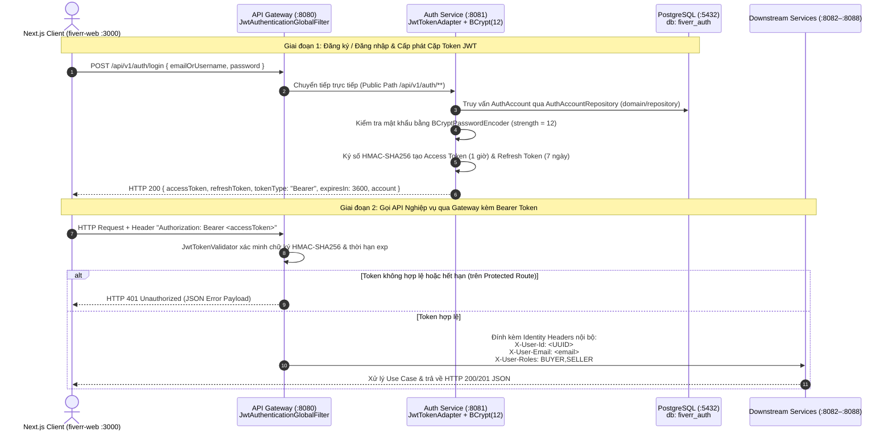

# 08. Cơ chế Xác thực & Bảo mật Tập trung (Stateless JWT Edge Authentication & Security)

Hệ sinh thái **FIVERREX (`fiverr-club`)** áp dụng mô hình **Stateless JWT Edge Authentication kết hợp Identity Header Propagation** theo chuẩn kiến trúc Microservices & Hexagonal Architecture (Ports and Adapters).

Thay vì buộc cả 8 dịch vụ nghiệp vụ (`:8081`–`:8088`) phải tự kết nối cơ sở dữ liệu định danh hoặc cấu hình lặp lại bộ lọc giải mã JWT, nhiệm vụ **cấp phát định danh** được tách biệt hoàn toàn vào `fiverr-auth-service (:8081)` và nhiệm vụ **kiểm tra chữ ký số / phân quyền tại biên** được thực thi tập trung tại `fiverr-api-gateway (:8080)`.

---

## 1. Sơ đồ Luồng Xác thực Tổng thể (End-to-End Authentication Sequence)



---

## 2. Quản lý Định danh & Cấp phát Token tại `fiverr-auth-service (:8081)`

`fiverr-auth-service` là dịch vụ duy nhất sở hữu cơ sở dữ liệu `fiverr_auth` (gồm bảng `auth_accounts` và `auth_account_roles`) và chịu trách nhiệm toàn bộ vòng đời định danh theo kiến trúc **DDD + Hexagonal**:

### 2.1. Cấu trúc Tầng trong `fiverr-auth-service`
- **Domain Layer (`domain/`)**:
  - Aggregate Root: `AuthAccount` (`id`, `username`, `email`, `passwordHash`, `roles: Set<AccountRole>`, `status: AccountStatus`, `lastLoginAt`).
  - Value Objects / Enums: `AccountRole` (`BUYER`, `SELLER`, `ADMIN`), `AccountStatus` (`ACTIVE`, `SUSPENDED`, `DELETED`).
  - Domain Repository Interface: `domain/repository/AuthAccountRepository.java` (**luôn nằm trong tầng `domain/repository/`**).
- **Application Layer (`application/`)**:
  - Inbound Use Cases (`application/port/in/`):
    - `RegisterAuthAccountUseCase` (`POST /api/v1/auth/register`)
    - `LoginAuthAccountUseCase` (`POST /api/v1/auth/login`)
    - `RefreshTokenUseCase` (`POST /api/v1/auth/refresh`)
    - `ChangePasswordUseCase` (`PUT /api/v1/auth/accounts/{id}/password`)
    - `GetAuthAccountUseCase` (`GET /api/v1/auth/accounts`, `GET /api/v1/auth/accounts/{id}`)
  - Outbound Service Ports (`application/port/out/`):
    - `PasswordEncoderPort`: Băm và đối chiếu mật khẩu.
    - `JwtTokenPort`: Sinh Access Token, Refresh Token và xác thực Refresh Token.
    - `AuthEventPublisherPort`: Phát sự kiện định danh lên Kafka (`auth.events`).
- **Infrastructure Layer (`infrastructure/`)**:
  - `PasswordEncoderAdapter`: Sử dụng `BCryptPasswordEncoder(12)` từ Spring Security.
  - `JwtTokenAdapter`: Sử dụng thư viện `io.jsonwebtoken (JJWT 0.12.6)` với thuật toán `HMAC-SHA256`.

### 2.2. Cấu trúc Claims của JWT Access Token & Refresh Token

```java
// Trích từ: fiverr-auth-service/.../infrastructure/adapter/JwtTokenAdapter.java
@Override
public String generateAccessToken(AuthAccount account) {
    Instant now = Instant.now();
    List<String> roleNames = account.getRoles().stream()
            .map(AccountRole::name)
            .toList();

    return Jwts.builder()
            .subject(account.getId().toString())          // UUID của tài khoản
            .claim("username", account.getUsername())     // Ví dụ: "jordan_taylor"
            .claim("email", account.getEmail())           // Ví dụ: "jordan.taylor@fiverr.club"
            .claim("roles", roleNames)                    // Ví dụ: ["BUYER", "SELLER"]
            .claim("type", "access")                      // Phân biệt với Refresh Token
            .issuedAt(Date.from(now))
            .expiration(Date.from(now.plusSeconds(3600))) // Hết hạn sau 1 giờ (3600s)
            .signWith(secretKey)                          // Ký HMAC-SHA256 (256-bit secret)
            .compact();
}
```

| Loại Token | Claim `type` | Thời hạn mặc định | Mục đích sử dụng |
|---|---|---|---|
| **Access Token** | `"access"` | `3600 giây` (1 giờ) | Đính kèm vào header `Authorization: Bearer <token>` khi gọi các REST API qua Gateway `:8080`. |
| **Refresh Token** | `"refresh"` | `604800 giây` (7 ngày) | Gửi tới `POST /api/v1/auth/refresh` để nhận cặp Access/Refresh Token mới khi Access Token hết hạn. |

### 2.3. Tài khoản Seeded Mặc định trong PostgreSQL (`fiverr_auth`)

Khi khởi động, `AuthDataInitializer.java` tự động khởi tạo 3 tài khoản mẫu (mật khẩu chung: `Password123!`):

| UUID | Username | Email | Roles | Vai trò trên UI |
|---|---|---|---|---|
| `11111111-1111-1111-1111-111111111111` | `alex_architect` | `alex.rivera@fiverr.club` | `BUYER`, `SELLER` | Top Rated Principal Java/Cloud Architect |
| `22222222-2222-2222-2222-222222222222` | `elena_ai` | `elena.rostova@fiverr.club` | `BUYER`, `SELLER` | Level 2 AI & Next.js Full-Stack Specialist |
| `33333333-3333-3333-3333-333333333333` | `jordan_taylor` | `jordan.taylor@fiverr.club` | `BUYER`, `SELLER` | Tài khoản mặc định trên `fiverr-web` |

---

## 3. Xác thực Biên & Truyền Ngữ cảnh Định danh tại `fiverr-api-gateway (:8080)`

Trên tầng API Gateway (`Spring Cloud Gateway Reactive WebFlux`), bộ lọc toàn cục `JwtAuthenticationGlobalFilter` (với độ ưu tiên `Order = -100`) chặn trước mọi request đi vào hệ thống:

```java
// Trích từ: fiverr-api-gateway/.../filter/JwtAuthenticationGlobalFilter.java
@Component
public class JwtAuthenticationGlobalFilter implements GlobalFilter, Ordered {

    public static final String HEADER_USER_ID = "X-User-Id";
    public static final String HEADER_USER_EMAIL = "X-User-Email";
    public static final String HEADER_USER_ROLES = "X-User-Roles";

    @Override
    public Mono<Void> filter(ServerWebExchange exchange, GatewayFilterChain chain) {
        String path = exchange.getRequest().getURI().getPath();
        if (isPublicPath(path)) {
            return chain.filter(exchange);
        }

        String authHeader = exchange.getRequest().getHeaders().getFirst(HttpHeaders.AUTHORIZATION);
        if (authHeader == null || !authHeader.startsWith("Bearer ")) {
            return writeUnauthorizedResponse(exchange, "Missing or malformed Authorization Bearer token");
        }

        String token = authHeader.substring(7).trim();
        Optional<JwtClaimsPayload> payloadOpt = jwtTokenValidator.validateAndExtract(token);
        if (payloadOpt.isEmpty()) {
            return writeUnauthorizedResponse(exchange, "Invalid or expired JWT token");
        }

        JwtClaimsPayload payload = payloadOpt.get();
        ServerHttpRequest mutatedRequest = exchange.getRequest().mutate()
                .header(HEADER_USER_ID, payload.userId())
                .header(HEADER_USER_EMAIL, payload.email())
                .header(HEADER_USER_ROLES, String.join(",", payload.roles()))
                .build();

        return chain.filter(exchange.mutate().request(mutatedRequest).build());
    }
}
```

### Cơ chế Identity Header Propagation (Truyền Header Nội bộ)
Sau khi `JwtTokenValidator` xác thực chữ ký `HMAC-SHA256` thành công tại Gateway, Gateway sẽ tự động tiêm (mutate) 3 HTTP Headers vào request trước khi chuyển tiếp xuống các microservices nội bộ (`:8082`–`:8088`):
1. `X-User-Id`: UUID của tài khoản đã xác thực (ví dụ `33333333-3333-3333-3333-333333333333`).
2. `X-User-Email`: Địa chỉ email của người dùng.
3. `X-User-Roles`: Chuỗi quyền phân tách bằng dấu phẩy (`BUYER,SELLER`).

Nhờ cơ chế này, các dịch vụ `fiverr-order-service`, `fiverr-payment-service`, `fiverr-messaging-service`, `fiverr-review-service` hoàn toàn **stateless** và đọc trực tiếp định danh người dùng từ header mà không cần giải mã lại JWT.

---

## 4. Tích hợp JWT Session trên Frontend (`fiverr-web`)

Trong `fiverr-web/src/lib/api.ts`, phiên đăng nhập (`AuthSession`) được lưu trữ đồng bộ tại `localStorage` (`fiverrex_auth_session_v1`) và tự động đính kèm vào mọi lệnh gọi `fetchWithFallback()`:

```typescript
// Trích từ: fiverr-web/src/lib/api.ts
function buildAuthHeaders(extraHeaders?: HeadersInit): Record<string, string> {
  const session = getAuthSession();
  const headers: Record<string, string> = {
    "Content-Type": "application/json",
    "X-User-Id": session.account.id,
    "X-User-Email": session.account.email,
    "X-User-Roles": (session.account.roles || ["BUYER", "SELLER"]).join(","),
  };
  if (session.accessToken) {
    headers["Authorization"] = `Bearer ${session.accessToken}`;
  }
  return headers;
}
```

Trên thanh điều hướng `Navbar.tsx`:
- Người dùng có thể bấm vào **User Profile Pill** ở góc phải để mở **Account & JWT Auth Modal**.
- Hỗ trợ **Chuyển đổi nhanh (1-Click Switch)** giữa 3 tài khoản PostgreSQL (`Jordan Taylor`, `Alex Rivera`, `Elena Rostova`), hoặc thực hiện **Sign In (`POST /api/v1/auth/login`)** / **Register (`POST /api/v1/auth/register`)** để lấy JWT thật từ `fiverr-auth-service`.

---

## 5. Chế độ Demo/Swagger Mở vs. Chế độ Strict JWT Production

Trong file `fiverr-api-gateway/src/main/resources/application.yml`, danh sách đường dẫn công khai được cấu hình qua biến `security.jwt.public-paths`:

- **Chế độ Demo & Kiểm thử Swagger UI (Mặc định hiện tại)**:
  ```yaml
  security:
    jwt:
      secret: ${JWT_SECRET:fiverr-club-super-secret-signing-key-must-be-at-least-256-bits-long-2026}
      public-paths: /api/v1/auth,/api/v1/users,/api/v1/profiles,/api/v1/sellers,/api/v1/gigs,/api/v1/categories,/api/v1/orders,/api/v1/payments,/api/v1/wallets,/api/v1/messages,/api/v1/conversations,/api/v1/reviews,/api/v1/notifications,/api/v1/search,/actuator,/fallback
  ```
  Cho phép lập trình viên mở trực tiếp Swagger UI (`http://localhost:8080/swagger-ui/index.html`) và trải nghiệm toàn bộ 28 API trên giao diện `fiverr-web` ngay lập tức mà không bị chặn `HTTP 401`.

- **Chế độ Strict JWT Production (Bắt buộc `Bearer Token` cho các API nhạy cảm)**:
  Khi triển khai môi trường khóa chặt, chỉ cần rút gọn `public-paths` về các API tra cứu công khai:
  ```yaml
  security:
    jwt:
      secret: ${JWT_SECRET}
      public-paths: /api/v1/auth,/api/v1/gigs,/api/v1/categories,/api/v1/reviews,/actuator,/fallback
  ```
  Khi đó, mọi yêu cầu Đặt hàng (`/api/v1/orders`), Giữ/Giải ngân Ký quỹ (`/api/v1/payments`), Rút tiền (`/api/v1/wallets`), hay Nhắn tin (`/api/v1/messages`) nếu thiếu header `Authorization: Bearer <valid_jwt>` sẽ bị `JwtAuthenticationGlobalFilter` chặn ngay tại cổng `:8080` với mã lỗi `401 Unauthorized`.

